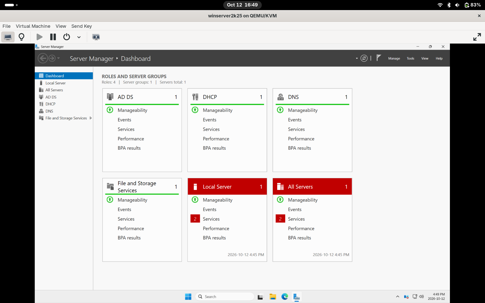
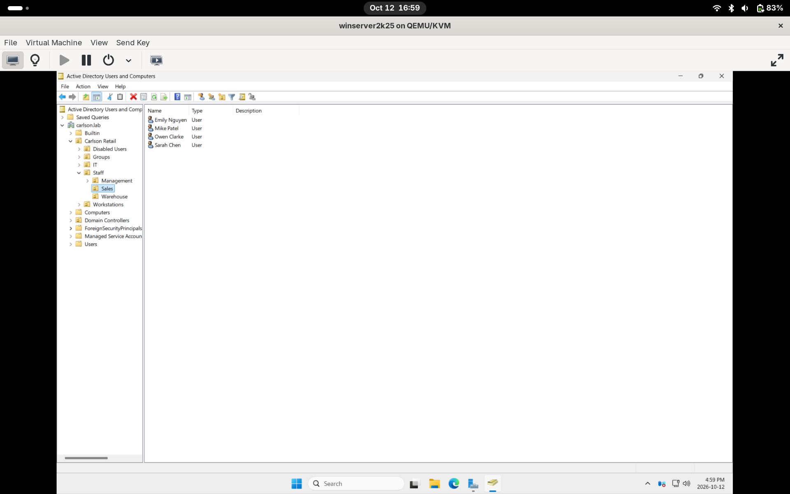
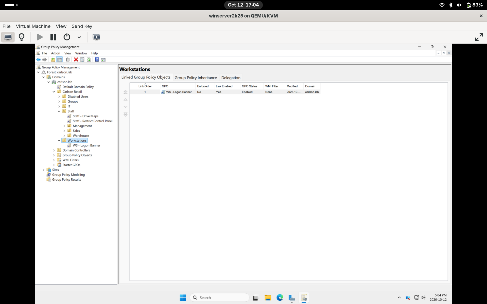
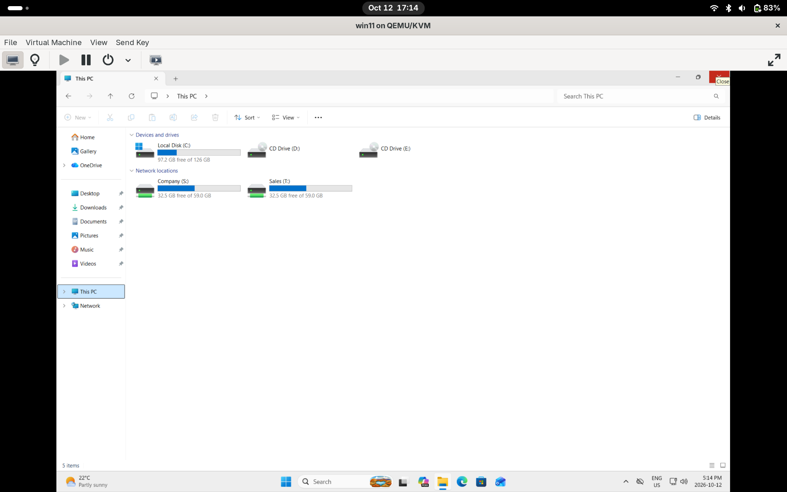

# Windows Server and Active Directory Lab

I built this lab to get more familiar with Windows Server and Active Directory, and to show some hands-on Windows work alongside my Linux skills. It does not make me an expert. It is a small home lab where I set up a Windows domain for a made-up company, Carlson Retail Group, and worked through some common help desk tasks.

## Lab Setup

- **Host:** Fedora Linux, running the VMs with KVM and virt-manager
- **DC01:** Windows Server 2025 (domain controller, DNS, DHCP, file shares)
- **CLIENT01:** Windows 11 Pro, joined to the domain
- **Network:** a private virtual network called adlab (10.10.10.0/24)
- **Domain:** carlson.lab

Most of the work was done in the Windows GUI tools (Server Manager, Active Directory Users and Computers, DNS, DHCP, Group Policy Management), with short PowerShell commands to check that each step worked.

## What I Built

- **Active Directory:** the carlson.lab domain, with OUs for each department (Sales, Warehouse, Management, IT), users, and security groups. I also made a separate admin account for myself instead of using my normal account for admin work.
- **DNS:** a reverse lookup zone and forwarders so the domain can still reach the internet.
- **DHCP:** a scope that hands out addresses to the client, with the gateway and DNS server set.
- **File shares:** one folder per department, with NTFS permissions set by group so each department only sees its own folder.
- **Group Policy:**
  - Password and account lockout policy
  - A logon banner on the workstation
  - Control Panel blocked for staff
  - Drive maps that show up based on which group a user is in
- **Domain-joined client:** CLIENT01 joined to carlson.lab and tested with different users.

## PowerShell Script

`scripts/Add-NewHires.ps1` creates new user accounts from a CSV file. For each new hire, it puts them in their department OU and adds them to their department group. The users have to change their password the first time they log in.

I put this script together with help from AI and Microsoft's documentation. I kept it short on purpose so I understand every line of it.

`scripts/new_hires_sample.csv` is the sample file it reads (made-up names only).

## Help Desk Tickets

I broke things on purpose and then fixed them the way a help desk tech would:

1. **Account locked out:** a user typed the wrong password too many times. I unlocked the account and used Event Viewer (event 4740) to find which PC caused the lockout.
2. **No access after a group change:** a user was removed from a group and added back, but still had no access. The fix was having them log off and back on to get a new login token.
3. **Offboarding:** disabled a departing user's account, added a note, removed their group access, and moved them to a Disabled Users OU.

## What I Learned

- After adding someone to a group, they have to log off and back on before the new access works.
- If a password doesn't meet the domain's password policy, the account can still get created, but it is disabled with no password. I hit this one myself while running the script.
- Small things matter. My script failed the first time because the CSV file was saved with the wrong name.

## Skills Used

Active Directory, DNS, DHCP, Group Policy, NTFS and share permissions, PowerShell, Windows 11 domain join, help desk troubleshooting

## Screenshots

**Server roles installed on DC01**

**OU structure in Active Directory Users and Computers**

**Group Policy objects and their links**

**Mapped drives for a Sales user**

The rest of the screenshots are in the [screenshots](screenshots/) folder.
